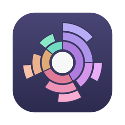
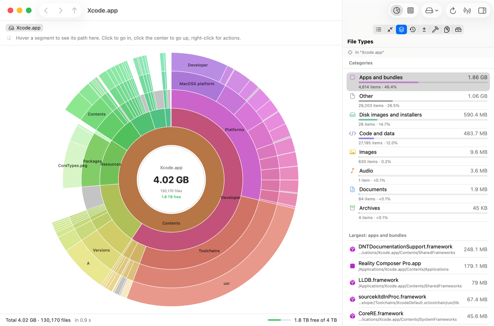
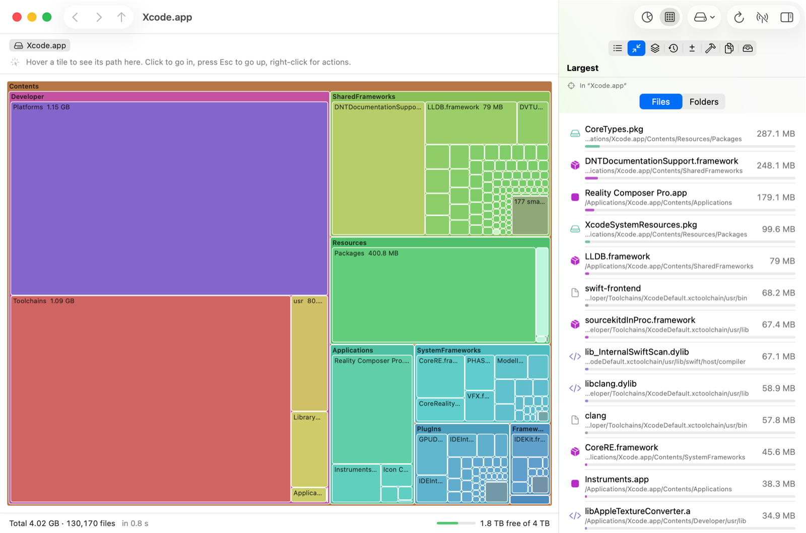

# DiskPie

A native macOS disk usage analyzer. It scans a disk or folder and shows where the space went as a sunburst (rings) or a treemap. Click into folders, click the center to go back up. Hover a segment to see its path; right-click it to reveal it in Finder or move it to the Trash.







The interface is available in English and Russian and follows the macOS language setting.

## Download

Grab the latest `DiskPie-x.y.z.zip` from [Releases](https://github.com/x2web/DiskPie/releases), unzip it and move `DiskPie.app` to `/Applications`. Release builds are signed with a Developer ID and notarized by Apple.

Requires macOS 14 Sonoma or later. Universal binary (Apple silicon and Intel).

## Features

- **Sunburst and treemap** views (⌘1 / ⌘2) that fill in progressively while a parallel scanner works.
- **Navigation:** click a segment to enter it. Click the center or press Esc to go up. Breadcrumbs, back and forward (⌘[ / ⌘]).
- **Instant path on hover**, with size, share of the parent and file count.
- **Context menu:**
  - open, Reveal in Finder, Quick Look (Space), copy path;
  - add to the collector;
  - move to Trash (⌘⌫, selection only, always confirmed), delete permanently;
  - rescan the folder.
- **Free space** on the volume, in the status bar and in the chart center.
- **Inspector panels:**
  - **Contents:** children of the current folder by size.
  - **Largest:** biggest files or folders at any depth.
  - **File types:** video, archives, disk images, apps and more. App bundles count as one item.
  - **Not touched for a long time:** files older than a chosen age.
  - **What changed:** compares the current scan with an earlier saved one and shows what grew, appeared or disappeared.
  - **Developer caches:** Xcode DerivedData, Archives, DeviceSupport, SwiftPM, CocoaPods, Gradle, npm, Homebrew and others, with one-click cleanup to the Trash. It also lists `node_modules`, `Pods`, `.build` and similar folders found in the scan. Simulator data, runtimes, the Android SDK and Docker are only shown; their own tools should clean them.
  - **Duplicates:** compared by exact length, then head and tail hash, then full SHA-256. Hard links are not duplicates. "Keep first" re-verifies contents before trashing anything.
  - **Collector:** a staging area for deletion candidates with the total you will reclaim.
- **Saved scans:** every scan is saved as a compact snapshot and can be reopened instantly from the start screen.
- **Live updates** via FSEvents: changed folders are re-read without a full rescan.
- **Drag a folder** onto the window to scan it.

## How sizes are counted

- **Allocated space** (`st_blocks × 512`), not logical size: sparse files count what they actually occupy.
- **Hard links** are counted once.
- **Symlinks** are not followed.
- **Other volumes** mounted inside the scanned folder are skipped. Scanning `/` does not count the data volume twice, because firmlinks already lead into it.
- **Hidden space:** when you scan a volume root, the gap between used space and the sum of files is shown as a gray "system and hidden" segment. It covers APFS snapshots, purgeable space, service volumes and unreadable folders.
- **APFS clones** are counted once per copy, so the sum can exceed used space. The status bar then says by how much.

## Full Disk Access

Without Full Disk Access some folders cannot be read: Mail, Messages, Safari, app containers. DiskPie checks access whenever it becomes active and walks you through enabling it in System Settings → Privacy & Security → Full Disk Access.

Even with Full Disk Access some system folders can still be unreadable. Click "no access" in the status bar to see which folders failed and why:

- **Owned by root**, such as `/private/var/db` or the MDM profile store. Use *Scan as administrator…*: the same binary runs in a CLI mode through the standard macOS password prompt and writes a snapshot that the app opens. No helper daemon is installed.
- **Protected by SIP**, such as Apple Intelligence model assets. These cannot be read at all.

## Building from source

Requires Xcode 15.3+ (Swift 5.10+).

```bash
./scripts/build-app.sh          # build/DiskPie.app for local use
open build/DiskPie.app
```

The local build is signed with the first *Apple Development* identity found in the keychain. The identity is remembered in `.signing-identity`, which git ignores. A stable signature keeps Full Disk Access granted across rebuilds. Set `DISKPIE_SIGN_IDENTITY` to override it.

### Release

```bash
./scripts/release.sh 1.0.0              # universal build, Developer ID, notarization, zip
./scripts/release.sh 1.0.0 --publish    # same, plus tag v1.0.0 and a GitHub release via the API
```

One-time setup:

1. A *Developer ID Application* certificate in the login keychain.
2. A notarytool profile:

   ```bash
   xcrun notarytool store-credentials diskpie-notary --apple-id <apple-id> --team-id <team-id>
   ```

3. For `--publish`: a GitHub token in the keychain. `scripts/publish-release.sh` reads it with `security find-generic-password` and never prints it.

Override the defaults with `DISKPIE_RELEASE_IDENTITY`, `DISKPIE_NOTARY_PROFILE`, `DISKPIE_GITHUB_REPO`, `DISKPIE_GITHUB_KEYCHAIN_SERVICE` and `DISKPIE_GITHUB_KEYCHAIN_ACCOUNT`.

### Developer flags

```bash
DiskPie --render <folder> <out.png> [sunburst|treemap] [subfolder]  # scan and render the chart offscreen
DiskPie --analyze <folder>                                          # print inspector analyses, check snapshot format
DiskPie --denied <folder>                                           # list unreadable folders grouped by reason
DiskPie --scan <folder> --out <file>                                # full scan into a snapshot file
```

Launch arguments for demos and screenshots:

```bash
open build/DiskPie.app --args -AppleLanguages "(en)" --open-path /Applications/Xcode.app --view treemap --tab largest --no-save
```

- `--open-path`: start scanning the folder.
- `--view`: `sunburst` or `treemap`.
- `--tab`: `contents`, `largest`, `types`, `old`, `changes`, `dev`, `duplicates` or `collector`.
- `--no-save`: do not keep a snapshot.

### Localization

English is the source language: UI strings live in the code as `String(localized:)`. The Russian translation is in `Resources/ru.lproj/Localizable.strings`, keyed by the English text; `InfoPlist.strings` holds the privacy prompts. Plural forms are chosen in `Fmt` according to the UI language.

## Layout

| Path | What it does |
|---|---|
| `Sources/DiskPie/Scan/Scanner.swift` | `fts` traversal with a shallow mode for progressive scans |
| `Sources/DiskPie/Scan/ScanCoordinator.swift` | Reads the root and first level, scans grandchildren in parallel, attaches results as they finish |
| `Sources/DiskPie/Model/AppModel.swift` | State, navigation, deletion, snapshots, FSEvents |
| `Sources/DiskPie/Views/` | `Canvas`-based charts, panels and the start screen |

The tree is mutated on the main actor only. Background work refers to nodes by path, and every tree replacement bumps a generation, so late results are dropped.

## License

MIT, see [LICENSE](LICENSE).
